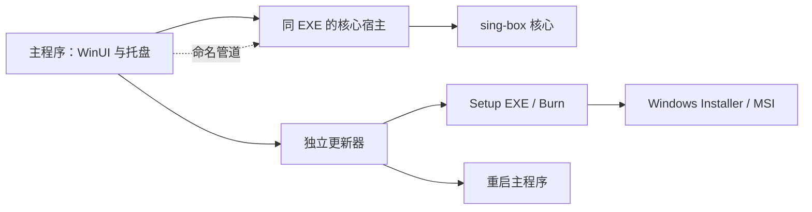

# 项目架构

这是 Windows x64 桌面客户端，没有独立的 Web 后端。界面管理配置和进程，网络流量由 sing-box 核心处理。源码分为三个 .NET 项目。

## 模块与进程

| 模块 | 职责 | 运行形式 |
| --- | --- | --- |
| `FluentSingBox.Client` | WinUI 3 窗口、托盘、节点、DNS、路由、配置、核心启停与更新入口 | `fluent sing-box.exe` |
| `SingBoxCoreHost` | 管理核心子进程，与主界面通过命名管道通信；需要 TUN 权限时提升权限 | 同一个 EXE 的 `--fluent-sing-box-core-host` 模式，没有单独项目 |
| sing-box | 根据配置监听本地代理或创建 TUN，执行 DNS 与流量路由 | 单独的 `sing-box.exe`，随应用内置，也可指定其他核心 |
| `FluentSingBox.Updates` | 版本和资产选择、哈希、签名清单、Authenticode 校验、更新状态文件 | 被客户端和更新器共同引用的 DLL，不是后台进程 |
| `FluentSingBox.Updater` | 等待主程序退出、重新验证安装器、安装、核对目标版本并重启主程序 | `FluentSingBox.Update.exe`，仅更新时运行 |
| WiX Burn / MSI | 安装目录、程序文件替换、升级注册、卸载与回滚 | Setup EXE 封装 MSI，安装期间运行 |

出现两个同名客户端进程时，其中一个可能是核心宿主，并不一定是开了两个界面。关闭主窗口默认收起托盘；托盘退出和更新退出走完整清理。更新器不是常驻服务，托盘属于主程序。

## 主程序内部

- `Views/`：XAML 页面、编辑表单与交互事件。
- `Models/`：节点、程序组、规则和应用偏好。
- `AppState`：加载、保存偏好和模型，协调自动保存。
- `ConfigurationFileService`、`ConfigurationComposer`、`SingBoxConfigBuilder`：维护可编辑配置、合并应用管理的内容、生成运行配置；保存时校验，合法变更不会自动热加载正在运行的核心。
- `SingBoxCoreService`：核心检查、宿主启动、命名管道、停止与异常恢复。`SingBoxCoreHost` 也定义在该源码文件中。
- `ProxyCoordinator`、`WindowsProxyService`：系统代理与应用分流偏好的应用和清理；核心启停由主窗口负责，系统代理开关与核心开关独立。
- `AppUpdateService`：检查版本、下载和进度、更新偏好、通知、周期工作与退出安装交接。

这是页面、服务和模型组成的桌面结构，并非所有页面都使用独立 ViewModel。单例与静态服务是当前的组织方式。

## 程序与数据分离

安装目录存放 EXE、DLL、XAML 资源、模板、规则集、第三方许可及 `release.json`。当前用户安装默认在 `%LOCALAPPDATA%/Programs/fluent sing-box`；全机安装默认在 Program Files。

运行数据默认在 `%LOCALAPPDATA%/fluent sing-box`：

| 文件 | 用途 |
| --- | --- |
| `settings.json` | 客户端偏好、节点、程序组等 |
| `sing-box/user-config.json` | 可编辑的完整配置 |
| `sing-box/config.json` | 核心下次启动使用的配置快照 |
| `sing-box/` | 核心、规则集更新、日志等运行数据 |
| `updates/state.json` | 更新状态、自动安装和通知偏好 |
| `updates/` | 下载缓存、临时更新器与安装日志 |

环境变量 `FLUENTSINGBOX_DATA_DIR` 的优先级最高，用于隔离测试；否则，EXE 旁有 `portable.txt` 时使用同目录 `data`。安装更新替换程序文件，不把用户数据装进 MSI。

## 更新链路

1. 修改代码并提交，提升 `release.json` 版本，运行相关检查。
2. `Build-Installer.ps1` 自包含构建客户端和更新器，生成用户或全机范围的 MSI/EXE。构建过程不会自动发布。
3. 发布本机签名清单，或者上传 GitHub 稳定 Release。现有 Actions 使用手动触发，不是 push/tag 自动发布。
4. 主程序手动或后台检查，比对版本，选择同范围的 x64 EXE，下载并校验可信来源。
5. 保存配置、停止核心、完成本应用网络清理后，主程序退出。任何清理失败会阻止进入安装。
6. 复制到缓存目录的独立更新器等待原进程退出，再次校验安装器，以 `/install /passive /norestart` 调用 Burn，保存日志，核对实际安装版本后重启应用。

`/passive` 跳过交互向导，但可以显示进度窗口。自定义 WiX 主题提供图标、版本、中英文文字及真实进度条；它不是额外的 WinUI 更新窗口。

更新有两种可信来源：

- **本机开发通道**：包内固定 RSA 公钥和本机目录，读取签名的 `latest.json`，验证清单签名及安装器哈希。本机当前安装使用此通道；删除目录、私钥或替换公钥可能使后续开发更新中断。
- **GitHub 通道**：读取 Releases API，跳过草稿和预发布，验证资产来源、SHA-256 和固定发布者的 Authenticode 签名。未签名测试 Release 可手动下载，不等于可信自动更新已经打通；私有仓库还需要可访问的发布方式。

默认自动安装关闭、通知开启。启动约 30 秒后开始后台工作，每 6 小时唤醒；版本检查间隔至少一天。开启自动安装后，后台可走完整升级流程；计费、漫游、超额或成本未知的网络不自动下载。手动检查不受一天间隔限制。

## 更新后的启动行为

主窗口默认进入服务器页，更新器只重启 EXE，不指定设置页，也不切换更新选项。此前看到的页面跳转和勾选来自辅助验收脚本，该脚本现已移除。通知默认开启，已有保存的选择继续保留。

## 文档与产物

构建、签名、更新通道和验收边界见[安装与发布](installer-validation.md)；构建工具与产物保留边界见[开发工具](development-tools.md)。历史计划、逐次验收日记及已被当前说明覆盖的讨论文档已合并，历史内容可从 Git 查阅。
