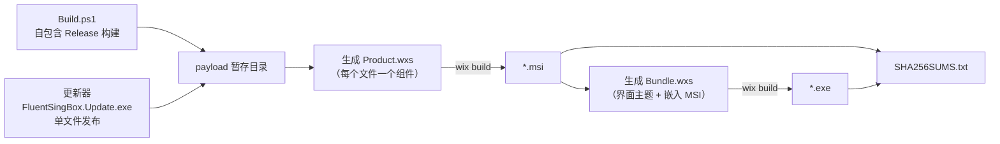
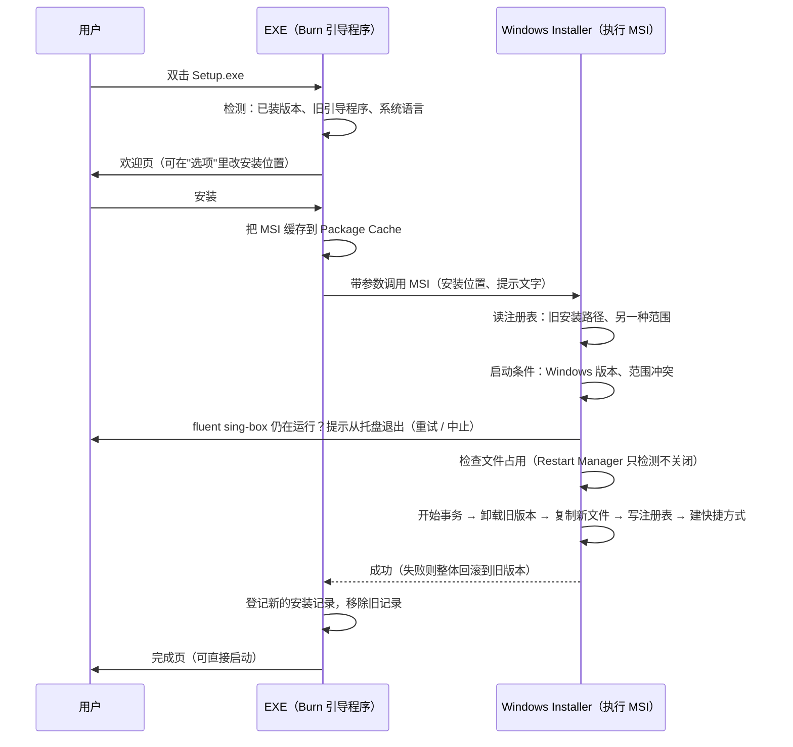

# 安装器是怎么工作的

这份文档面向第一次接触 Windows 安装包的读者，讲清楚 fluent sing-box 的安装器做了什么、EXE 和 MSI 有什么区别。

- 构建命令和正式签名见[安装与发布](installer-validation.md)。
- 应用内更新的进程关系见[项目架构](architecture.md)。

本文描述的行为以 `tools/Build-Installer.ps1` 生成的安装包为准（0.1.16 起）。

## 一句话版本

- **MSI** 是 Windows 自带的"安装数据库"。它记录要放哪些文件、写哪些注册表、建哪些快捷方式，然后由系统的 Windows Installer 服务照着执行。
- **EXE** 是一个"引导程序"（WiX 的 Burn），里面装着同一个 MSI。它负责显示中英文的安装界面、让用户选择安装位置、记录日志，然后把 MSI 交给 Windows Installer 去装。
- 两者装出来的程序文件完全一样。**普通用户用 EXE**；MSI 留给需要用命令行或企业管理工具（组策略、Intune 等）批量部署的场景。

## 一共有哪几个文件

每次构建会在 `artifacts/installers/<版本>/` 下生成：

| 文件 | 安装范围 | 默认安装位置 | 需要管理员权限 |
| --- | --- | --- | --- |
| `FluentSingBoxUserSetup-<版本>-x64.exe` / `.msi` | 仅当前用户 | `%LOCALAPPDATA%\Programs\fluent sing-box` | 不需要 |
| `FluentSingBoxSetup-<版本>-x64.exe` / `.msi` | 本机所有用户 | `C:\Program Files\fluent sing-box` | 需要（安装时弹一次 UAC） |
| `SHA256SUMS.txt` | — | — | 上面四个文件的校验值 |

- **两种范围不能共存。** 已经装了用户版，就不能直接装全机版，反之亦然。安装程序会提示先卸载另一种，配置会保留。
- **推荐用户版 EXE。** 它不需要管理员权限，应用内更新也最顺畅。
- **安装包是自包含的。** 里面带了 .NET 运行时和 WinUI，用户不需要另装 .NET。所以每个安装包都有一百多 MB。

## 构建时发生了什么

1. **构建程序。** 先自包含构建主程序，再把更新器发布成单个 EXE，两者一起复制进暂存目录。暂存目录里还会写入 `release.json`（版本号、GitHub 仓库、发布者证书指纹）和 `install-scope.txt`（`user` 或 `machine`）。脚本会检查暂存目录里没有 `portable.txt` 和用户数据，避免把开发机上的配置打进安装包。
2. **生成 MSI。** 脚本为暂存目录里的每个文件生成一个 MSI"组件"，组件 ID 由文件路径算出，保证每个版本都一样。然后调用 WiX 编译出 MSI。
3. **生成 EXE。** 把 MSI 嵌进 Burn 引导程序，再配上自定义主题（`installer/FluentTheme.xml`）和中英文界面文字（`installer/Strings.*.wxl`）。
4. **签名（可选）。** 如果提供了代码签名证书，会依次给程序文件、MSI、Burn 引擎和外层 EXE 签名。目前没有配置证书，所以构建出来的是未签名的测试包，只能手动安装。
5. **生成校验值。** 写出 `SHA256SUMS.txt`，生成的 WiX 源文件保存在 `build-sources/` 里，方便排查问题。

## 双击 EXE 之后的完整流程

下面以"已装 0.1.15，再双击 0.1.16 用户版 EXE"为例。

每一步的具体内容：

1. **检测。** Burn 会查找已安装的旧版本：既包括旧的 EXE 安装记录，也包括单独装过的 MSI。同时根据系统语言选择中文或英文界面。比较版本时，比当前包更新的版本会被拒绝（不允许降级）。
2. **选择安装位置。** 欢迎页的"选项"可以改安装目录。如果你没有改，升级时会沿用旧版本的安装目录，这个目录记录在注册表 `Software\PhotonNomad\FluentSingBox\Install\Path`。
3. **缓存。** Burn 把自己和 MSI 复制到 `%LOCALAPPDATA%\Package Cache\{…}`（全机版在 `C:\ProgramData\Package Cache`）。以后卸载、修复都要用到这份缓存。
4. **进入 MSI。** 下面几步都由 Windows Installer 执行：
   - **启动条件。** 要求 Windows 10 19041 或更高版本；如果另一种安装范围已经存在，就拒绝安装。
   - **"正在运行"提示。** 如果检测到 `fluent sing-box.exe` 在运行（包括只在托盘里），会弹出提示，请你从托盘选择"退出"再点"重试"；点"中止"会取消安装。安装器故意不自动关闭程序：直接结束进程会跳过恢复系统代理和停止核心，可能让你断网。
   - **检查文件占用。** 用 Restart Manager 按文件的真实路径检查是否被占用，不会误报其他程序。0.1.15 及以前用的是旧机制，会把"设置"、资源管理器这类加载了同名 DLL 的程序当成占用者。
   - **事务式安装。** 先卸载旧版本，再复制新文件、写注册表、建开始菜单快捷方式。整个过程是一个事务：中途失败会回滚，旧版本原样恢复。
5. **收尾。** Burn 在"设置 → 应用"里登记新版本，并移除旧版本的登记。

日志在 `%TEMP%\fluent_sing-box_<时间>.log`（EXE 的日志）和同名的 `…_000_…msi.log`（MSI 的详细日志）。安装出问题时，先看这两个文件。

## 安装器到底改了电脑上的哪些东西

| 位置 | 内容 | 卸载时 |
| --- | --- | --- |
| 安装目录（见上表） | 程序、运行时、更新器、`release.json`、`install-scope.txt` | 删除 |
| 开始菜单 `fluent sing-box` | 快捷方式 | 删除 |
| 注册表 `HKCU`（全机版是 `HKLM`）`\Software\PhotonNomad\FluentSingBox` | 安装路径、范围，以及 MSI 用来跟踪组件的记录 | 删除 |
| "设置 → 应用"里的条目 | 由 EXE 登记；MSI 自己的条目是隐藏的（避免列表里出现两条） | 删除 |
| `Package Cache` | EXE 和 MSI 的缓存副本 | 删除 |

安装器**不会**动下面这些东西：

- **用户数据目录** `%LOCALAPPDATA%\fluent sing-box`：节点、设置、日志、下载的核心都在这里。升级和卸载都会保留它，所以重装后配置还在。
- **开机自启动。** 自启动项由应用里的设置写入 `HKCU\…\Run`，不是安装器写的。卸载时，安装器只会调用 `fluent sing-box.exe --remove-startup-entry`，删掉指向本安装目录的那一条；升级时不会删。
- **系统服务、驱动、防火墙规则、系统代理。** 安装器一律不碰。TUN 网卡由运行中的核心按需创建，和安装器无关。

## EXE 和 MSI 的区别

| | EXE（Burn 引导程序） | MSI（Windows Installer 包） |
| --- | --- | --- |
| 本质 | 一个小程序，内含 MSI | 一个数据库文件，由系统服务解释执行 |
| 界面 | 自定义主题，自动切换中文或英文 | WiX 标准向导，只有英文 |
| 选择安装位置 | "选项"页 | 向导里的目录页 |
| "正在运行"提示 | 中文或英文 | 英文（MSI 只能存单字节文字） |
| "设置 → 应用"里的条目 | 由 EXE 登记 | 直接装 MSI 时由 MSI 登记 |
| 命令行 | `Setup.exe /install /passive /norestart /log x.log`、`/uninstall`、`/quiet` | `msiexec /i x.msi /qn`、`msiexec /x …` |
| 适合场景 | 普通用户双击安装；**应用内更新也调用 EXE** | 组策略、Intune 等企业批量部署，或需要直接控制 MSI 参数的场景 |
| 文件内容 | 完全相同 | 完全相同 |

**不要混用 EXE 和 MSI。** 比如这次用 EXE 装、下次直接装 MSI，或者反过来。混用会留下多余或孤立的安装记录。安装 0.1.15 时的日志里出现过一条找不到旧 0.1.13 引导程序缓存的非致命错误，很可能就和之前混用两种安装包有关。用 EXE 装的，以后就一直用 EXE。

## 应用内更新怎么调用安装器

应用内的"安装更新"也是运行同一个 EXE，只是不显示向导，过程如下：

1. 应用从 GitHub Releases 下载对应安装范围的 EXE，校验 SHA-256，再校验发布者签名。
2. 应用先自己执行完整的退出清理：恢复系统代理、停止核心、保存设置。
3. 把更新器复制到数据目录的 `updates\runner-…` 里运行。这样安装器替换安装目录时，不会碰到正在运行的更新器本身。
4. 更新器等主程序退出，再校验一次安装包，然后运行 `Setup.exe /install /passive /norestart`。`/passive` 表示只显示进度条，不需要点按钮。
5. 安装成功后，更新器核对新版本并重新启动应用。

因为第 2 步已经让应用完整退出，自动更新时不会出现"正在运行"的提示。

目前没有配置发布者证书，第 1 步的签名校验一定会失败，所以现在只能按本文的方式手动安装。

## 常见问题

- **装完配置还在吗？** 在。配置在数据目录，安装器不碰。
- **能装旧版本吗？** 不能直接降级，要先卸载新版本，再装旧版本（配置仍会保留）。
- **用户版换全机版？** 先在"设置 → 应用"里卸载用户版，再装全机版。
- **安装时提示正在运行？** 右键托盘图标选"退出"，再点"重试"。不要用任务管理器强行结束，否则可能留下失效的系统代理。
- **注销或关机时应用还开着会怎样？** 从 0.1.16 起，应用会在 Windows 结束会话前同步恢复系统代理并停止核心。
